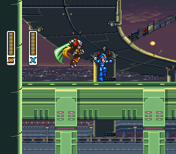
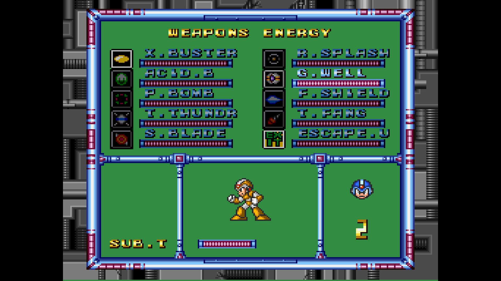
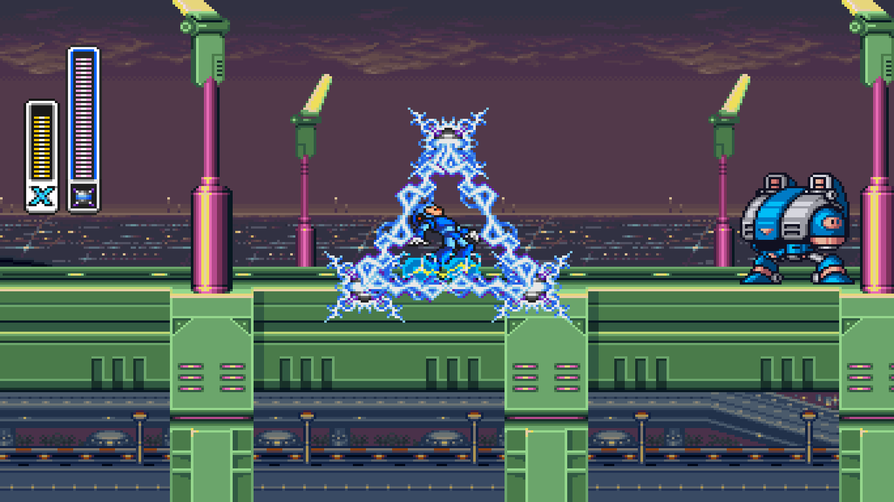

# Mega Man X Recompiled

## Windows frame composition

The pinned shared framework uses cached HLE frame composition by default on
Windows x64. Guest CPU, mapper, audio and status behavior keep their existing
interfaces; this is a host presentation optimization. For the maintained
correctness-reference compositor, configure a separate Release build with
`cmake -S . -B build-frame-lle -DCMAKE_BUILD_TYPE=Release -DSNESRECOMP_FRAME_IMPL=LLE`,
then `cmake --build build-frame-lle`. Selection is fixed at build time.
LLE can reduce performance; it remains available for correctness checks. Other
platforms keep LLE defaults, and existing CMake cache selections are preserved.
See [HLE defaults and opt-out](snesrecomp/docs/HLE_DEFAULTS.md).

The reviewed native-view, uncapped Windows route measured 340.936 to 889.911 FPS
(+161.02%, process CPU -67.17%); it includes boot/menu work and active gameplay.
The owner accepted the normal-paced adaptive HLE build. These figures describe
that measured build/route, not a new measurement of subsequent upstream title
changes or other platforms. Foreign compiler activity limits precision.
Normal play retains normal pacing/audio. See the shared framework's
[frame model](snesrecomp/docs/FRAME_MODEL_HOSTS.md) for the host/guest boundary.

Play *Mega Man X* on PC with playable Zero, couch co-op and online netplay,
all sixteen X2/X3 boss weapons, and adaptive widescreen. Choose Zero's original
X3 combat, the optional Modern style with direct saber attacks, a second
jump, and an air dash, or [Saber Zero](#saber-zero) by RaphaelAzev.

[Download](https://github.com/mstan/MegaManXSNESRecomp/releases/latest) |
[Getting started](#quick-start-pre-built-release) | [Netplay setup](docs/netplay.md)

## Saber Zero

**Saber Zero** is contributed by [RaphaelAzev](https://github.com/RaphaelAzev),
from the [MegaManXSNESRecompSaberZero](https://github.com/RaphaelAzev/MegaManXSNESRecompSaberZero)
fork. It gives Zero a Y-button Z-Saber: a 3-hit ground combo, air, wall and dash
slashes, the X3 finisher with its Saber wave, hit-priority follow-ups, and Ride
Armor pilot art. The X button keeps Zero's buster and special weapons.
After any two of the eight Maverick bosses are defeated, Up+Y performs the
uppercut on the ground or during a dash; after any three, it performs the
rolling slash in the air.

Choose **Zero behavior → Saber Zero** in **Characters → Add Zero** (single
player; **Starting character** and native **Select** exchange are unchanged) or
in **Characters → Co-op** (Saber belongs to whichever seat is Zero). Both use
your own **Mega Man X3 USA** ROM selection. The optional **Characters → Saber
Zero settings** feature tunes damage, hit priorities, finisher window, swing
volume, and hitboxes; without it, Saber Zero uses its defaults. ROMs are never
included in this repository or its releases.

The Saber Zero sprites and sound effects come from the [Zashiko Mod](assets/saber-zero/CREDITS.md).
They are included for non-commercial use. This project is not monetized, and
the donor assets must not be used commercially.

Saber Zero can collect X1's armor upgrades as Zero. The Head part charges the
buster 1.5 times faster, halves X1 special-weapon energy cost, and breaks helmet
blocks. The Body part reduces all enemy damage taken by 25% for Saber Zero,
including contact and hits; X keeps native halving. The Arms part enables charged
X1 special weapons and Saber charge behavior. The Legs part grants double jump
and air dash, keeps charge through those moves, and refreshes both moves on a
moving platform. All four parts enable Black Zero's black-and-grey appearance,
pale hair, and grey death orbs. `start_all_upgrades` grants all four parts for
testing.

Saber Zero cannot attack while frozen by Chill Penguin. Held Fire Wave streams
like X. A Saber slash preserves a held special-weapon charge. Zero stays visible
in his idle stance during the armor capsule celebration.

### Saber Zero controls and attacks

The package keeps the native controls for movement and menus, with the following
Saber mapping:

| Input | Saber Zero behavior |
|-------|--------------------|
| **Y** | Saber. On the ground, press for slash 1 and press again during the combo windows for the 3-hit ground combo. In the air it starts an air slash; while clinging to a wall it starts a wall slash; during a grounded dash it starts a dash slash. Holding Y is one press, not an automatic combo. |
| **X** | Buster when the buster is selected, or the selected special weapon otherwise. Hold X to charge the buster and release it to fire; charge/release behavior is preserved through a Saber swing as described below. |
| **B** | Native jump. |
| **A** | Native dash. A direction remains native; a swing locks or masks movement/cancellation edges only for the attack phases that require it. |
| **Select** | Native X/Zero exchange when standing in a valid exchange context. |
| **L/R, Start, directions** | Continue to use the native weapon/menu/movement controls. |

The ground combo is slash 1 → slash 2 → slash 3. The first two swings accept
the next Y edge in their chain window and can buffer an early edge; slash 3 has
no fourth swing. Air, wall, and dash slashes are single attacks. Native jump,
dash, hurt, death, and character-exchange states still cancel or suppress Saber
ownership according to the current action, and a held direction cannot turn an
accepted swing.

### Buster, finisher, and wave behavior

Saber Zero uses the X3 Zero charge path with a Saber-specific cap. Charge reaches
tiers at 21, 81, and 141 held frames, then caps at 200 frames (tier 8); it does
not enter the upstream tier-10/third legacy route. The lower releases fire the
normal X3 buster classes. A capped charge produces the two-shot class-3 burst,
and the second shot is emitted at the same height as the first. A physical X
press or release during a Saber slash, finisher, or wave-shooting animation
cannot create a buster or special projectile in that locked animation. A held
charge and a release are retained so the first eligible frame after the swing
can complete the buster action.

To use the X3 finisher and Saber wave, release a capped charge for the first
class-3 shot, press X again for the second shot, then press Y during the
finisher window opened by that second burst. The default window is 27 frames;
the option table below can tune it. The X3 finisher starts first, and the Saber
wave is published during the finisher sequence. If the projectile pool cannot
reserve a wave slot, the window edge is still consumed and no wave is created.
X is gated for the duration of the finisher and wave-shooting animation.

### Hit priority

Each eligible hit records a priority. A later follow-up with a **higher**
priority can break an enemy's ordinary invincibility within the configured
window; equal or lower priorities do not. The default window is 70 frames. This
does not remove native forced-hit or reflection protections, and the special
Armadillo positive-response case remains limited to its exposed row.

The default priority ladder is:

| Priority | Actions |
|----------|---------|
| 1 | Air slash, wall slash, small charge, full charge |
| 2 | Ground slash 1, max shot 1 |
| 3 | Ground slash 2, max shot 2 |
| 4 | Ground slash 3, X3 finisher |
| 5 | Dash slash, Saber wave |

The Ride Armor pilot is drawn with the Saber donor overlay and aligned to the
native Ride Armor cockpit position and facing. With **Show hitboxes** enabled,
the custom renderer outlines enemy, Zero, and Saber attack hitboxes.

### Saber Zero package options

The package has `start`, `start_all_upgrades`, 31 numeric tuning options, and
`show_hitboxes`.

| Option | Default | Meaning |
|--------|---------|---------|
| `start` | `zero` | Starting character; `x` is also available. |
| `start_all_upgrades` | `false` | Give Zero all four X1 armor parts at stage or checkpoint start; intended for testing. |
| `slash1_damage` | `3` | Normal damage for ground slash 1. |
| `slash2_damage` | `3` | Normal damage for ground slash 2. |
| `slash3_damage` | `8` | Normal damage for ground slash 3. |
| `x3_finisher_damage` | `16` | Normal damage for the X3 finisher. |
| `air_damage` | `3` | Normal damage for an air slash. |
| `wall_damage` | `3` | Normal damage for a wall slash. |
| `dash_damage` | `3` | Normal damage for a dash slash. |
| `wave_damage` | `6` | Normal damage for each Saber wave pulse. |
| `boss_slash1_damage` | `1` | Boss damage for ground slash 1; `0` means use the normal value. |
| `boss_slash2_damage` | `1` | Boss damage for ground slash 2; `0` means use the normal value. |
| `boss_slash3_damage` | `2` | Boss damage for ground slash 3; `0` means use the normal value. |
| `boss_air_damage` | `1` | Boss damage for an air slash; `0` means use the normal value. |
| `boss_wall_damage` | `1` | Boss damage for a wall slash; `0` means use the normal value. |
| `boss_dash_damage` | `1` | Boss damage for a dash slash; `0` means use the normal value. |
| `boss_x3_finisher_damage` | `6` | Boss damage for the X3 finisher; `0` means use the normal value. |
| `boss_wave_damage` | `4` | Boss damage for a Saber wave pulse; `0` means use the normal value. |
| `slash1_priority` | `2` | Priority of ground slash 1. |
| `slash2_priority` | `3` | Priority of ground slash 2. |
| `slash3_priority` | `4` | Priority of ground slash 3. |
| `air_priority` | `1` | Priority of an air slash. |
| `wall_priority` | `1` | Priority of a wall slash. |
| `dash_priority` | `5` | Priority of a dash slash. |
| `charge_small_priority` | `1` | Priority of a small charged buster shot. |
| `charge_full_priority` | `1` | Priority of a full charged buster shot. |
| `max_shot1_priority` | `2` | Priority of the first max-charge shot. |
| `max_shot2_priority` | `3` | Priority of the second max-charge shot. |
| `x3_finisher_priority` | `4` | Priority of the X3 finisher. |
| `wave_priority` | `5` | Priority of the Saber wave. |
| `priority_window_frames` | `70` | Frames in which a higher-priority follow-up can break ordinary invincibility. |
| `finisher_window_frames` | `27` | Frames in which Y can trigger the X3 finisher after the second max shot. |
| `saber_swing_volume` | `50` | Saber swing sound-effect volume. |
| `show_hitboxes` | `false` | Draw debug hitboxes in the custom renderer. |

### Saber Zero armor upgrades and Black Zero

Zero shares X1's armor parts with X. All four parts unlock Black Zero, with
black-and-grey armor, pale hair, and grey death orbs. The Black Zero palette
uses colour values from the MMX3 Zero Project romhack; no ROM data is included.

Additional Zero saber techniques and Zero-related dialogue and other cutscene
entries remain planned.

### Conflicts and supported modes

Saber Zero is a Zero behavior for **Add Zero** and **Co-op**. It does not support
netplay yet. Select it in the relevant feature's **Zero behavior** field; the
Saber settings feature supplies its package options. The Zero plugin guards the
co-op and Saber Zero paths so the same Zero seat cannot activate incompatible
behaviors.

The other preloaded manifests checked for this fork use separate plugin keys:
X2/X3 weapons, widescreen, password saves, MSU-1, and the diagnostics packages
do not claim `megaman-x.zero`. That is a plugin-level compatibility check, not a
promise that every combination has been playtested.

### Building this fork with MSYS2/MinGW

On Windows, use Git Bash with the MSYS2 MinGW toolchain, CMake, Ninja, SDL3,
Git, and Python. From the repository checkout, a prepared fork build can be
built and tested with:

```bash
export PATH="/c/msys64/mingw64/bin:$PATH"
cd MegaManXSNESRecompSaberZero
cmake --build build-mingw
ctest --test-dir build-mingw --output-on-failure
bash tools/saber/run_saber_rom_tests.sh
```

The fork build still needs the player's own Mega Man X USA and Mega Man X3 USA
ROMs for play and ROM-backed tests. The full build command intentionally has no
target so that all configured targets are compiled. `build-mingw` uses Ninja
through CMake. On a fresh checkout, configure a new tree once before running
the build command:

```bash
cmake -S . -B build-mingw -G Ninja -DCMAKE_BUILD_TYPE=Release \
  -DMMX_STATE_TESTS=ON
```
The Saber sprites and sound effects come from the
[Zashiko Mod](assets/saber-zero/CREDITS.md). They are included with permission
for non-commercial use only. Controls, timings, the priority ladder and every
option are in the [Saber Zero reference](docs/saber-zero.md).

<a href="https://www.youtube.com/watch?v=TDysNWWJ25g">
  
</a>

*Click the thumbnail to watch the gameplay showcase on YouTube.*

<table>
  <tr>
    <td width="50%" align="center">
      
      <br><strong>X / Zero co-op</strong><br>Fight through X1 together, locally or over netplay.
    </td>
    <td width="50%" align="center">
      
      <br><strong>Modern Zero</strong><br>Direct saber attacks with movement during airborne swings.
    </td>
  </tr>
  <tr>
    <td width="50%" align="center">
      
      <br><strong>X2 / X3 weapon pages</strong><br>Sixteen imported boss weapons and their charged attacks.
    </td>
    <td width="50%" align="center">
      
      <br><strong>Imported weapons in action</strong><br>X3's Triad Thunder on X1's Highway.
    </td>
  </tr>
</table>

Gameplay screenshots from the [project preview](https://1379.tech/megaman-x-recompiled-coop-zero-weapons-wip/),
plus a Modern Zero capture from the current playtest.

## Features

Checked boxes indicate available features. Configure optional mods in the
launcher's **Mods** screen; these character and weapon mods target the USA
Rev 1 build.

| Available | Feature | What it adds |
|:---------:|---------|--------------|
| &#9745; | **Password saves (SRAM)** | Remembers the last generated password and prefills it on the next launch. Enabled by default. |
| &#9745; | **Adaptive widescreen** | Expanded gameplay with adaptive, 16:9, 21:9, and 32:9 views. |
| &#9745; | **Playable Zero** | X3 Zero with his buster/saber combo and grounded character switching. Separate health for X and Zero. |
| &#9745; | **Modern Zero** | Direct saber attacks, double jump, air dash, and movement during airborne swings. |
| &#9745; | **Co-op mode** | X and Zero on screen together, with independent health, weapons, and weapon energy. |
| &#9745; | **X2 weapons** | All eight boss weapons and their charged attacks, adapted for X and Zero. |
| &#9745; | **X3 weapons** | All eight boss weapons and their charged attacks, adapted for X and Zero. |
| &#9745; | **Netplay** | Two-player online co-op with lobbies and rollback, plus optional fixed widescreen. |

See the [co-op validation notes](docs/coop-port.md) for current limits.

## Quick start (pre-built release)

1. Download the latest [Windows ZIP or Linux AppImage](https://github.com/mstan/MegaManXSNESRecomp/releases/latest).
   Extract the ZIP on Windows, or make the AppImage executable on Linux.
2. Open the launcher and select your own **Mega Man X (USA) (Rev 1)** ROM
   (`.sfc` or `.smc`). Headered and unheadered ROMs are supported.
3. Configure your keyboard or controller in **Controls**.
4. Enable the features you want in **Mods**, then select **Play**.

For Zero or co-op, select your own **Mega Man X3 USA ROM** in Mods. The X3
weapon mod shares that selection. X2 weapons need your **Mega Man X2 USA ROM**.
Assets are extracted automatically on your machine.

Select **Modern** under **Zero behavior** in either Zero mod for saber combat
and extra aerial movement. **X3 Behavior** is the default. **Add Zero** and
**X / Zero Co-op** are alternatives; enabling one disables the other.

For widescreen, enable **Widescreen** in Mods and choose your view aspect.
**Display Aspect** in Settings controls pixel proportions. Netplay uses the
original view or fixed 16:9, 21:9, or 32:9.

Setup guides: [Zero](docs/zero-0.0.1.md), [X2/X3 weapons](docs/x-weapons-port.md),
[password saves](docs/password-saves.md), and [netplay](docs/netplay.md).
No ROMs or extracted assets are included in the downloads.

## Controls and co-op

Use the launcher's **Controls** screen to assign devices and remap buttons for
each player. Xbox, PlayStation, and Switch Pro controllers are supported.
For couch co-op, assign a controller or keyboard to each player. For netplay,
configure your local **Player 1** controls; the lobby assigns your game seat.

P2 joins automatically at a safe stage entrance in co-op. Hold P2 **Select**
for 1.5 seconds to withdraw, and tap it to rejoin. A player who dies can tap
**Select** to respawn beside the partner for one of the team's lives. Respawns
are not available during boss or miniboss fights; the request waits until the
fight is over, or until a 1-up is collected if no lives are left.

Reopen the launcher during play with **Ctrl+L** or controller **Select+L3**.
Configure system shortcuts in **Hotkeys**. **F7** opens the save-state browser
and **F8** opens rewind; both pause gameplay while you choose.

## Reporting problems

[Open an issue](https://github.com/mstan/MegaManXSNESRecomp/issues) with your
build, enabled mods, and steps to reproduce the problem. For gameplay bugs,
include a nearby save state and describe the inputs that trigger it.

Windows diagnostics are saved beside the executable in
`logs/mmx-<date>-<time>-<process-id>.log`; read-only installations use
`%TEMP%/MegaManXSNESRecomp/logs`. Attach that log and `last_run_report.json`.
If a crash produced `crash_report_*.json` or `crash_minidump_*.dmp`, include
those too. Grab the reports before running the game again.

Netplay disconnect details and long application stalls are logged automatically
in the session log. They distinguish a received peer goodbye from a timeout,
report the age of the last peer packet, and identify long gaps in network
processing or slow replay recording. Collect the session logs from both players
when a match disconnects; no Developer mod needs to be enabled.

For additional connection detail, enable the **Tier 2 diagnostics** mod
(Developer group) before hosting or joining. Each match then writes
`saves/netplay/net_diag.jsonl` (the transport, whether ICE connected directly,
through STUN or through TURN, and any stalls); attach it with the log. The
file is replaced by the next match.

Replay diagnostics are **enabled by default**, including when updating an
existing installation. Normal play records both players' inputs, machine
checkpoints, display settings and per-frame state checks. No Developer mod
needs to be enabled. When a problem occurs, stop playing and zip the session's
`logs/mmx-replay-*` files together, including **all `.replay`, `.replay.sav`,
`.config.ini`, `.mods.toml` and `.mods.txt` files**. A `.replay` alone is insufficient.
During netplay, collect the files from both players if possible. Describe what
happened and roughly when. Keep your source ROMs out of the attachment.

The newest six replay segments are kept (normally about a minute of gameplay;
rollback or frequent state loads can shorten this). Each segment is capped at
600 frame executions or 16 MiB of checkpoints. Run-ahead currently suspends
replay capture; turn it off while collecting a report. To opt out of automatic
recording, set the environment variable `MMX_REPLAY_RECORD=0` and leave the
Developer diagnostic options disabled.

For extra detail, enable **Co-op physics diagnostics** or **Tier 2 diagnostics**
under **Mods > Developer**. These optional detailed traces remain off by default;
the rolling replay capture runs without them.

The existing collision trace is written in 32 MiB
numbered segments (`logs/coop-physics-<start time>-<pid>-<n>-001.csv`, `-002.csv`,
...); the newest 32 are kept. Attach every segment of the session. During netplay
the same mod also writes `logs/coop-netplay-*` segments with the same name stem;
attach those too, from both players if possible.

Developers can reproduce a capture with the same build and owned source ROMs:

```sh
python tools/replay_diagnostic.py capture.replay --exe path/to/MegaManXSNESRecomp --rom path/to/mmx.sfc --x3-rom path/to/mmx3.sfc --headless
```

The helper stages the captured settings in a new directory, replays offline,
and stops at the first WRAM, co-op, camera-state or VRAM mismatch with a nonzero
exit status. Use `--until N` to stop after N executions, or omit `--headless`
to watch. A mismatch also saves `replay-divergence.sav` in the reproduction
directory. `--check` inspects the log without starting the game. A final input
without a completed checkpoint identifies an interrupted frame; it is reported
as incomplete, never as a successful replay. Playback executes that final input
so the original hang/crash can recur under a debugger. The format preserves actual
rollback executions and restored checkpoints, so do not deduplicate frame
numbers as an input-only CSV route would.

The ROM-backed acceptance suite is `tests/test_diagnostic_replay.py`; build
with `-DMMX_STATE_TESTS=ON` and supply `--state-tests`, `--game`, `--rom`,
`--assets` (your extracted X3 Zero cache), and a new `--work-dir`. An optional
`--fixture` pointing to an upgraded gameplay checkpoint also checks P2 X armor
arrival, native checkpoint restart, and original-ROM sprite transfers during
movement and dash.
Supply `--x3-rom` to also exercise desktop Saber Zero playback when the saved
offline preferences differ from the active mod selection.

To see collision boxes, tick **Hitbox overlay** under **Mods > Developer**. It
outlines each object's native hitbox: enemies red, players green (both players in
co-op), player shots yellow, Zero and Saber attacks cyan, enemy projectiles
magenta. It only draws, works with or without widescreen, and does not change the
game. Items and pickups are not outlined.

<details>
<summary>Building from source and technical details</summary>

## Building from source

Release notes belong in the GitHub release description. Do not create or commit
`RELEASE_NOTES*.md` files, or include them in release packages.

Clone with all framework dependencies, then run the idempotent
bootstrap check:

```bash
git clone --recurse-submodules https://github.com/mstan/MegaManXSNESRecomp.git
cd MegaManXSNESRecomp
bash tools/bootstrap.sh
```

The `snesrecomp/` directory is a pinned submodule from
[mstan/snesrecomp](https://github.com/mstan/snesrecomp), and `recomp-ui/`
is the shared launcher UI submodule. If you cloned without
`--recurse-submodules`, `tools/bootstrap.sh` initializes them and their
nested dependencies. The gitlink in this repository is the dependency pin;
there is no separate SHA to keep synchronized.

Generated game C is not redistributed. Before the first build, stage a legally
obtained USA Rev 1 ROM as `mmx.sfc`, then run:

```bash
cp "/path/to/Mega Man X (USA Rev 1).sfc" mmx.sfc
bash tools/regen.sh usa --no-tests
```

On Windows 10 or newer, install [MSYS2](https://www.msys2.org/) with the
mingw64 toolchain (`cmake`, `ninja`), the SDL3 development package, Git,
Python 3.9 or newer, and `rustup`. Run the bootstrap and regeneration steps
from Git Bash, then:

```bash
cmake -S . -B build-recompui -G Ninja -DCMAKE_BUILD_TYPE=Release \
  -DCMAKE_PREFIX_PATH=/path/to/SDL3/x86_64-w64-mingw32
cmake --build build-recompui
# or, packaged: SDL3_MINGW_ROOT=/path/to/SDL3 bash tools/build-windows-mingw.sh VERSION
```

SDL3 is the default. SDL2 remains an explicitly supported fallback: configure
a separate tree with `-DSNESRECOMP_SDL_BACKEND=SDL2`.

Windows releases use CMake/MinGW with the shared recomp-ui launcher
(`tools/make_release.ps1`). CMake is the maintained build definition on every
platform. Visual Studio users can open the repository as a CMake project or
configure with the Visual Studio generator and an MSVC-compatible SDL package.
The former manually maintained solution and source list have been retired.

### macOS / Linux (CMake)

Builds natively on macOS (Apple Silicon + Intel) and Linux with clang/gcc.
On macOS, install dependencies with
`brew install cmake sdl3 ninja python3`. On Ubuntu/Debian, install
`build-essential cmake ninja-build libsdl3-dev libgl1-mesa-dev python3`.

```bash
cmake -S . -B build-dev -G Ninja -DCMAKE_BUILD_TYPE=RelWithDebInfo
cmake --build build-dev --target MegaManXSNESRecomp
ctest --test-dir build-dev --output-on-failure
```

On Linux, `tools/build-linux-dev.sh` wraps those steps for a `build-linux/`
tree. It checks the toolchain, submodules, SDL3/SDL2 and generated code first
and prints the fix for anything missing, reuses the build directory, and can
stage and verify a ROM, regenerate, run the unit tests or launch the game:

```bash
bash tools/build-linux-dev.sh --rom /path/to/mmx.sfc   # first build from a ROM
bash tools/build-linux-dev.sh                           # incremental rebuild
bash tools/build-linux-dev.sh --tests --run             # test, then play
bash tools/build-linux-dev.sh --setup-host --tests      # ROM-free, like CI
```

See `bash tools/build-linux-dev.sh --help` for every option.

On macOS, add `-DCMAKE_PREFIX_PATH="$(brew --prefix)"` if CMake does not find
Homebrew's SDL3. Apple Silicon contributors running an x86_64-translated shell
must also configure with `-DCMAKE_OSX_ARCHITECTURES=arm64`. Packaging helpers
detect the native hardware architecture and are documented by
`bash tools/build-macos.sh --help` and `bash tools/build-linux.sh --help`.
The cross-platform Windows release can be built with MinGW using
`SDL3_MINGW_ROOT=/path/to/SDL3 bash tools/build-windows-mingw.sh VERSION`.
All release packages are ROM-free; place your legally obtained ROM beside the
executable or AppImage after extraction.
CI compiles both launcher/setup hosts without ROM-derived sources using
`-DSNESRECOMP_SETUP_HOST=ON`, plus the display geometry and widescreen policy
checks. A setup host cannot run the game until its generated sources are built.
For the focused real-ROM state check, add `-DMMX_STATE_TESTS=ON`, build
`mmx_state_tests`, then run:

```bash
python snesrecomp/runner/tests/run_mmx_state_tests.py \
  --exe build-dev/mmx_state_tests --rom mmx.sfc
```

See [CONTRIBUTING.md](CONTRIBUTING.md) for dependency development, validation,
and pull-request guidance.

macOS builds use the same SDL3 + CMake path as Linux. A native macOS
backend (Metal presentation, `GameController.framework`,
Core Audio output) and an optional in-game display menu were contributed
in [PR #10](../../pull/10) and are staged on per-feature branches; they
land after the shared launcher-UI restructure settles.

### Adaptive widescreen support

The adaptive widescreen renderer has been playtested through the ending on Windows. Enable **Widescreen**
on the launcher's **Mods** page. It is disabled by default; existing enabled
widescreen installations automatically use the replacement.

Choose **Adaptive** to fit the window, or **16:9**, **21:9**, or **32:9** for a
fixed view aspect. **Settings → Display Aspect** controls pixel and sprite
proportions in every mode: **4:3 (CRT)**, **8:7 (Square pixels)**, or
**1:1 (Square frame)**. For example, a 16:9 view with 8:7 selected shows more
scenery with square pixels. Adaptive follows the window's shape while preserving
the selected pixel proportions. The view is bounded by the native 256 pixels and
the renderer's 1024-pixel capacity; outside those bounds it is boxed to preserve
pixel shape. Health bars anchor to the screen edges, and expanded sprite
capacity draws sprites beyond the original frame limit. Menus and other native
screens remain pillarboxed. View aspect is the mod's only option.

The original stage camera, collision and encounter timing are preserved, with
scoped fixes for objects exposed by the wider view. The former legacy renderer
selector has been removed. Rockman X (Japan) continues to use its authentic view.

With the widescreen mod disabled, **Display Aspect** also determines the overall
shape of the native frame. With it enabled, **Mods → View aspect ratio** chooses
the view shape and **Display Aspect** continues to determine pixel shape.
Released saves and adaptive-playtest saves remain loadable. F7/F8 open the shared
save browser and rewind; the corresponding old slot loads are now F11/F12.

The S-DSP retains the SNES BRR predictor filters and canonical four-tap
Gaussian interpolation. Host-rate conversion uses continuous interpolation
instead of nearest-sample hold. The current SPC700 core is instruction-cycle
stepped with canonical opcode timing; a sub-cycle bsnes-style SPC700 core is a
separate emulator-core replacement and is not represented as complete here.

The supported packaged workflow is:

```bash
bash tools/build-macos.sh --rom "/path/to/your/rom.sfc" --regen --no-dmg
```

The script builds an arm64 `.app` by default; use `--arch universal` for an
Intel/Apple Silicon package. The ROM is used only for local regeneration and
is never copied into release output.

The recompiled C in `src/gen/` is **not** committed — contributors must
regenerate it from a local ROM before the first build. See the next
section.

### Regenerating the recompiled C (contributors)

1. Stage a legally-obtained USA Rev 1 ROM as `mmx.sfc` at the repo root
   (`.gitignore` excludes it), or pass it to `tools/build-macos.sh --rom`.
2. Run `bash tools/regen.sh usa --no-tests` (drives the recompiler over every
   `recomp/bank*.cfg` and writes `src/gen/bankXX_v2.c` + `dispatch_v2.c`).
   The script builds and requires the fast native analyzer by default; set
   `SNESRECOMP_ANALYSIS_BACKEND=python` only to use the slower reference path.
   On Windows without bash, invoke the underlying tool directly:
   ```bash
   python snesrecomp/tools/build_native_analyzer.py
   python snesrecomp/tools/v2_emit.py --rom mmx.sfc --cfg-dir recomp --out-dir src/gen --cfg-roots --analysis-backend native
   ```
3. Rebuild as above.

For Rockman X (Japan v1.1), stage `rockmanx.sfc` under
`variants/jp/roms/` and run `bash tools/regen.sh jp --no-tests`. The JP path
uses its checked-in LLE coverage profile as optional AOT input; variants the
compiler cannot prove remain on the authoritative interpreter fallback.
`bash tools/regen.sh all` regenerates both regions.

## What "static recompilation" means here

The 65816 CPU code from the ROM is statically translated to C — every
function the analysis can prove is a real generated C function in
`src/gen/`. Execution is **LLE-first**: an authoritative 65816
interpreter (LakeSnes-derived, MIT) is the correctness floor, and the
statically compiled bodies are exact, proven materializations on top of
it — anything the static pass cannot prove keeps running through the
interpreter, loudly. **The rest of the SNES is not recompiled** — it's
hardware. PPU rendering, the APU/SPC700 audio coprocessor, DMA and
HDMA channels, hardware register I/O, and bank-mapping run through
snesrecomp's own runner implementations (`snesrecomp/runner/`). Same
model as N64Recomp and similar projects: recompile the CPU, emulate the
silicon.

The ROM is **never** redistributed — you supply your own legally-dumped
copy.

## Repo layout

| Path | Purpose |
|------|---------|
| `src/` | Runtime C (CPU state glue, NMI orchestration, hand-written bodies for things the framework doesn't recompile). |
| `src/gen/` | Recompiler output (gitignored; regenerated from ROM). |
| `recomp/bank*.cfg` | Per-bank function declarations + hardware hints the framework cannot derive from the ROM alone. |
| `recomp/funcs.h` | Auto-regenerated by `tools/regen.sh`; never hand-edit. |
| `snesrecomp/` | Pinned submodule containing the [snesrecomp framework](https://github.com/mstan/snesrecomp). |
| `recomp-ui/` | Pinned submodule containing the shared, console-agnostic launcher UI. |
| `third_party/` | Remaining game dependencies and their licenses. |
| `CMakeLists.txt` | Shared framework build helpers and USA/JP targets. |
| `config.ini` | The config. Generated next to the exe on first run if missing. |

</details>

## Disassembly annotations

[bogaa/dizProjects](https://github.com/bogaa/dizProjects) is pinned at
`third_party/dizProjects`. Its X1 project supplies named gameplay routines,
sprite/data tables and player RAM fields. The tracked [symbol metadata](symbols/README.md)
names discovered code and adds searchable annotations during regeneration.
Reviewed project names keep precedence. Search with
`python tools/diz_annotations.py --query charge`.

## License

PolyForm Noncommercial 1.0.0. See `LICENSE`. Code in this repo is
original; vendored dependencies under `third_party/` retain their own
licenses.

The *Mega Man X* ROM and any data extracted from it are **not** in
this repo and are not licensed for redistribution.

---

<p align="center">
  <sub><b>R.A.I.D. — Retro AI Development</b> · a Discord for AI-assisted retro reverse-engineering, decomp &amp; recomp</sub>
</p>

<p align="center">
  <a href="https://discord.gg/Ad9BwSzctP"></a>
</p>
